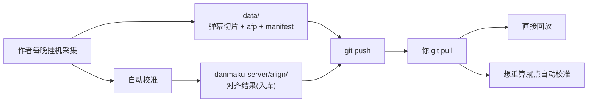

# 分发与使用（不含采集的人怎么用）

> 这套东西有两种用法：**自己采集**（见 `README.md`）和**直接用作者的数据**（本文）。
> 后者不需要你挂机、不需要 B 站账号。

## 一句话

```
git clone → 双击启动脚本 → 打开网页 → 选场次 → 看
```

---

## 你需要什么

| 项 | 说明 |
|---|---|
| Windows + Python 3.12 | 或直接用仓库里配好的 `.venv`（首次需 `pip install -r`） |
| 磁盘 | 一晚约 17 MB，一届 Worlds 约 300 MB |
| 网络 | 拉数据用 `git pull`；看视频直连 B 站 CDN，不经过作者 |
| **不需要** | B 站账号、挂机、自己装 ffmpeg（依赖里已含） |

## 三步开始

### 1. 准备 Python

只需 **Python 3.12+**（[python.org](https://www.python.org/downloads/) 下载，安装时勾选 `Add python.exe to PATH`）。

### 2. 拿到数据与代码

```powershell
git clone https://github.com/root9701/danmaku-timewarp.git
cd danmaku-timewarp
```

### 3. 双击启动

双击 `danmaku-server\启动回放台.bat`。**首次运行会自动创建虚拟环境并安装依赖**（约 1~3 分钟，仅一次），完成后浏览器自动打开 `127.0.0.1:8789`。

> 依赖装不上多半是网络问题，用国内镜像：
> `danmaku-server\.venv\Scripts\python.exe -m pip install -r danmaku-server\requirements.txt -i https://pypi.tuna.tsinghua.edu.cn/simple`

之后每次更新：

```powershell
git pull          # 只拉新增的弹幕与指纹(每晚约 17 MB), 不会重下历史
```

> 装了新依赖或改了代码时，重启启动脚本即可；只更新数据不用重启。

---

## 你能做什么

| 操作 | 能 | 说明 |
|---|---|---|
| 播放、拖进度、调倍速 | ✅ | 完全本地，不走服务器 |
| 换官方回放 BV | ✅ | 「自定义回放源」里填 |
| 手动微调 offset（±30/10/5 秒） | ✅ | 立即生效，存在你自己的 `matches.json` |
| **重新自动校准** | ✅ | **可以**——数据包含音频指纹(afp) |
| 采集新的比赛 | ❌ | 需要采集环境，见 `README.md` |

> **关于自动校准**：这需要音频指纹。本仓库的数据**包含 afp**，所以你可以对任意分P
> 重算 offset——比如作者算错了、或者官方回放被重新上传换了音轨，你不必等人修，自己点一下就行。
> 代价是数据体积更大（afp 占约 35%），见下面「数据体积」。

---

## 数据从哪来



**弹幕与音频指纹在仓库根的 `data/`，对齐结果在 `danmaku-server/align/`。** 三者都由 `git pull` 更新。

### 数据体积

| 内容 | 每晚 | 占比 | 能否再生 |
|---|---|---|---|
| 弹幕切片（gzip） | 约 10 MB | 65% | ❌ 直播流消失后无法重采 |
| 音频指纹 afp | 约 5–7 MB | 35% | ❌ 同上，且是自动校准的唯一依据 |
| 对齐结果 `align/` | 几 KB | — | ✅ 有 afp 就能重算 |

**afp 不可再生**，这是为什么它必须入库（`业务约束.md` 有红线约束）。

---

## 你自己的改动会不会丢

不会。你的改动写在 `danmaku-server/matches.json`（**不入库**），优先级高于 `align/`：

```
align/{日期}.json     ← 上游，git pull 覆盖
matches.json          ← 你的微调，永远保留
```

合并粒度是**单场比赛**：你只改 `HLE vs IG`，其他场次继续跟随上游更新。

---

## 更新什么、怎么更新

三样东西独立更新，机制不同：

| 更新什么 | 何时 | 怎么做 | 要重启吗 |
|---|---|---|---|
| **数据**（`data/`、`align/`） | 作者每晚采集后 | `git pull` | ❌ 不需要，刷新网页即可 |
| **代码**（`server.py`、`web/`） | 作者改功能时 | `git pull` | ✅ 要重启启动脚本 |
| **依赖**（`requirements.txt`） | 依赖清单变更时 | `pip install -r` | ✅ 要重启 |

**怎么知道代码更新了要重启？** 看 `git pull` 的输出：

```
若出现 danmaku-server/server.py 或 danmaku-server/web/  → 重启
只出现 data/ 或 align/                                  → 刷新网页即可
```

浏览器有强缓存，代码更新后**必须硬刷新**（`Ctrl+F5`），否则可能还在跑旧 JS。

### 依赖更新（重要）

`requirements.txt` 用的是 `==` 精确版本，不是 `>=`。原因是：

- **numpy 1.x → 2.x 有破坏性 API 变更**，校准算法大量用 FFT 与数组运算，
  版本漂移可能让它**静默算错**（算出一个看着正常的错误 offset）而不是报错——这是最难发现的失败方式。
- **imageio-ffmpeg 自带 ffmpeg 二进制**，版本间抽音频行为可能不同，而整个指纹流程都依赖它。

所以：**作者升级依赖时会在提交说明里标注**，看到就执行一次 `pip install -r`。

---

## 常见问题

**问：某场弹幕错位了怎么办？**
答：先点「自动校准」重算（你的数据含 afp，能算）。还不对再用「手动微调」自己校正。
若确认是算法问题，去开 issue。

**问：`git pull` 很久？**
答：数据每晚约 17 MB。第一次 clone 要下全量（一届约 300 MB），之后只拉增量。

**问：能离线看吗？**
答：弹幕与指纹完全离线，但视频流要联网（B 站 CDN）。除非你自己把视频也下下来。

**问：能不能只拉某几天？**
答：不能，`git pull` 是全量的。但你可以只保留需要的日期目录，程序会忽略不存在的日期。

**问：我不想要音频指纹，能不能小一点？**
答：可以，但它不是默认。仓库维护者可用 `python tools/pack_data.py --strip-afp`
生成不含 afp 的副本（弹幕约 10 MB/晚，代价是失去自动校准能力）。
自己删 `data/*/**/*.afp.jsonl` 也能省空间，但**删了就永远不能自动校准那几晚**。

---

## 数据边界（作者侧已知限制）

| 情况 | 表现 |
|---|---|
| 直播只播了部分内容 | 该分P 只有部分片段能对齐，其余回放内容播不了 |
| 赛前评论在开播前 | 该分P 无音频 → 未对齐，其余正常 |
| 早上重播过 | 已被时间窗拒绝，不会错位采纳 |
| 官方回放重导音轨 | afp 是对直播音频算的，重导后可能对不上，需手动微调 |

这些不是缺陷，是「只录弹幕不录视频」这套方案的物理边界。
