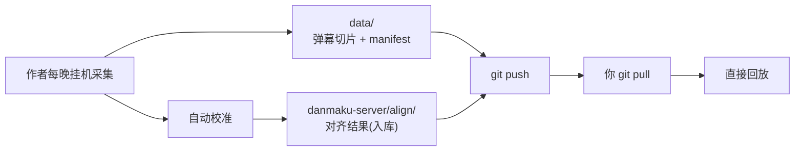

# 分发与使用（不含采集的人怎么用）

> 这套东西有两种用法：**自己采集**（见 `README.md`）和**直接用作者的数据**（本文）。
> 后者不需要你挂机、不需要 B 站账号、不需要 ffmpeg。

## 一句话

```
git clone → 双击启动脚本 → 打开网页 → 选场次 → 看
```

---

## 你需要什么

| 项 | 说明 |
|---|---|
| Windows + Python 3.12 | 或直接用仓库里配好的 `.venv`（首次需 `pip install -r`） |
| 约 300 MB 磁盘 | 一届 Worlds 的弹幕数据 |
| 网络 | 只用于拉 B 站回放视频流（直连 CDN，不经过作者） |
| **不需要** | B 站账号、挂机、ffmpeg、音频指纹 |

## 三步开始

```powershell
git clone <本仓库地址> lol延时直播
cd lol延时直播
# 首次: 装依赖
danmaku-server\.venv\Scripts\python.exe -m pip install -r danmaku-server\requirements.txt
```

然后双击 `danmaku-server\启动回放台.bat`，浏览器会自动打开 `127.0.0.1:8789`。

之后每次更新：

```powershell
git pull          # 只拉新增的弹幕(每晚约 10 MB), 不会重下历史
```

---

## 你能做什么 / 不能做什么

| 操作 | 能 | 说明 |
|---|---|---|
| 播放、拖进度、调倍速 | ✅ | 完全本地，不走服务器 |
| 换官方回放 BV | ✅ | 「自定义回放源」里填 |
| 手动微调 offset（±30/10/5 秒） | ✅ | 立即生效，存在你自己的 `matches.json` 里 |
| **重新自动校准** | ❌ | 需要音频指纹（作者的私产，体积是弹幕的 1.8 倍） |
| 采集新的比赛 | ❌ | 需要 `danmaku-collector/` 和采集环境 |

> 想自己采集？看 `README.md` 和 `danmaku-collector/README.md`。

---

## 数据从哪来



**弹幕在仓库根的 `data/`，对齐结果在 `danmaku-server/align/`。** 两者都由 `git pull` 更新。

---

## 你自己的改动会不会丢

不会。你的改动写在 `danmaku-server/matches.json`（**不入库**），优先级高于 `align/`：

```
align/{日期}.json     ← 上游，git pull 覆盖
matches.json          ← 你的微调，永远保留
```

合并粒度是**单场比赛**：你只改 `HLE vs IG`，其他场次继续跟随上游更新。

---

## 常见问题

**问：为什么自动校准按钮点了报错？**
答：你拿到的是**弹幕包**，不含音频指纹（afp）。这是设计如此——指纹每晚 6 MB，只有重新校准才用得上。作者已经把 offset 算好放在 `align/` 里了。

**问：某场弹幕错位了怎么办？**
答：先用「手动微调」自己校正。若是作者的 offset 算错了，去开 issue，下个版本会修。

**问：`git pull` 很久？**
答：只有**第一次** clone 需要下全量（约 300 MB）。之后每晚增量约 10 MB。

**问：能离线看吗？**
答：弹幕完全离线，但视频流要联网（B 站 CDN）。除非你自己把视频也下下来。

---

## 数据边界（作者侧已知限制）

| 情况 | 表现 |
|---|---|
| 直播只播了部分内容 | 该分P 只有部分片段能对齐，其余回放内容播不了 |
| 赛前评论在开播前 | 该分P 无音频 → 未对齐，其余正常 |
| 早上重播过 | 已被时间窗拒绝，不会错位采纳 |
| 官方回放重导音轨 | 自动校准会拒绝，需手动微调 |

这些不是缺陷，是「只录弹幕不录视频」这套方案的物理边界。
