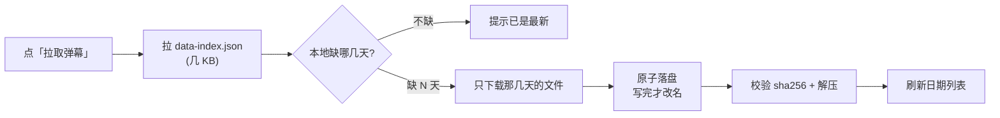
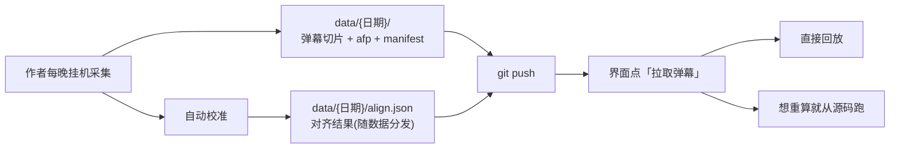
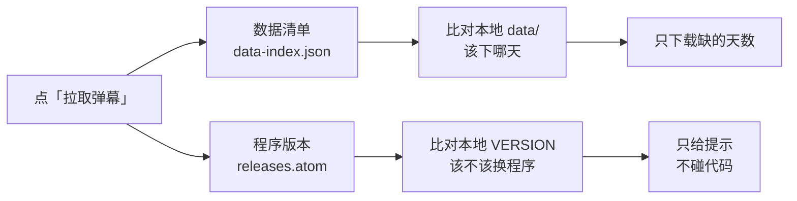

# 分发与使用（不含采集的人怎么用）

> 这套东西有两种用法：**自己采集**（见 `README.md`）和**直接用作者的数据**（本文）。
> 后者不需要你挂机、不需要 B 站账号。

## 两种拿到的方式

| | 便携包（推荐） | 从仓库 clone |
|---|---|---|
| 需要装 Python | ❌ 自带解释器 | ✅ Python 3.12 + `pip install` |
| 需要会命令行 | ❌ 双击即可 | ✅ `git clone` |
| 数据 | 面板里点「拉取弹幕」下载 | `git pull` |
| 更新程序 | 重新下载包 | `git pull` |
| 适合谁 | 普通玩家 | 想改代码 / 跑校准的人 |

便携包**只发一个版本**：解压即用、不含自动校准。校准结果由作者算好并随数据下发
（`data/{日期}/align.json`），打开就能看；需要自己对任意分P 重算 offset 的人，
本来就有开发环境，从仓库 clone 跑更合适（见下方「从仓库 clone」）。

| 版本 | 下载(zip) | 解压后 | 自动校准 | 手动微调 | 说明 |
|---|---|---|---|---|---|
| **便携版** | 约 14 MB | 约 37 MB | ❌ | ✅ | 校准结果已由作者做好，打开就能看 |

打包：`python tools/release.py` —— 一条命令跑完
校验 → 闸门 → 回归 → 重生成清单 → 出包 → **空 `APPDATA` 端到端实测**。
加 `--publish` 还会打 tag、推送、建 Release 并把 zip 传上去（`--dry-run` 可先看它要做什么）。

> 体积两个数都列出来，别只写一个：`dist/` 里躺着的是解压后的目录，
> 而用户下载的是 zip。只写解压体积会让人以为包变大了。

**便携版不含 `data/`** —— 数据在面板里下载，这样新数据出来不用重发包。

## 一句话

```
git clone → 双击启动脚本 → 打开网页 → 选场次 → 看
```

---

## 你需要什么

| 项 | 说明 |
|---|---|
| Windows + Python 3.12 | 便携包不用；clone 的话首次需 `pip install -r` |
| 磁盘 | 一晚约 17 MB，一届 Worlds 约 300 MB |
| 网络 | 拉数据用「拉取弹幕」（走公共镜像）或 `git pull`；看视频直连 B 站 CDN，不经过作者 |
| **不需要** | B 站账号、挂机、自己装 ffmpeg（依赖里已含） |

## 三步开始

### 1. 准备 Python

只需 **Python 3.12+**（[python.org](https://www.python.org/downloads/) 下载，安装时勾选 `Add python.exe to PATH`）。

### 2. 拿到数据与代码

```powershell
git clone https://github.com/root9701/danmaku-timewarp.git
cd danmaku-timewarp
```

### 3. 双击启动

双击 `danmaku-server\Start.bat`。**首次运行会自动创建虚拟环境并安装依赖**（约 1~3 分钟，仅一次），完成后浏览器自动打开 `127.0.0.1:8789`。

> 依赖装不上多半是网络问题，用国内镜像：
> `danmaku-server\.venv\Scripts\python.exe -m pip install -r danmaku-server\requirements.txt -i https://pypi.tuna.tsinghua.edu.cn/simple`

之后每次更新：

**方式一（推荐）：点界面上的「拉取弹幕」按钮。** 程序会比对远端清单，只下载缺的日期，完成后自动刷新日期列表。不用装 git、不用命令行。

**方式二：命令行 `git pull`。** 适合已经把仓库 clone 下来、习惯用 git 的人：

```powershell
git pull          # 只拉新增的弹幕与指纹(每晚约 17 MB), 不会重下历史
```

> 装了新依赖或改了代码时，重启启动脚本即可；只更新数据不用重启。

### 「拉取弹幕」怎么工作



设计上刻意保守：

- **只写新的日期目录**，绝不改动已有数据（afp 不可再生，写错就是永久损坏）
- **原子落盘**：先写 `.part` 再改名，断网不会留下半个文件
- **校验 sha256 + 解压**：截断、等长篡改都会被挡在落盘之前
- **幂等**：重复点不会重复下载
- **并发 4 路**：每个文件有 2-3 秒固定开销（建连/镜像重定向），串行下 21MB 要 72 秒，
  并发后约 38 秒
- **不碰代码**（见上一节）

### 数据从哪些通道下

官方 `raw.githubusercontent.com` 在中国大陆被单独限速（实测 7MB 要 30 秒以上甚至超时），
所以按速度依次尝试免费公共镜像，官方地址放最后兜底：

| 通道 | 实测速度 | 说明 |
|---|---|---|
| `gh-proxy.com` | 1.75 MB/s | 首选 |
| `ghfast.top` | 1.38 MB/s | 次选 |
| `fastly.jsdelivr.net` | 0.33 MB/s | CDN，全球可用 |
| `raw.githubusercontent.com` | 超时/30s | 官方源，有代理时最可靠 |

**镜像都是第三方，不受我们控制**，所以清单里带每个文件的 sha256：对不上就丢弃该通道换下一个。
若两个独立镜像给出**逐字节相同**却都不符合哈希的内容，说明是清单本身错了（不是镜像的问题），
此时立刻停止并提示"这是发布方的问题"——否则会把 21MB 在每个通道各下一遍，用户以为程序卡死。

`data-index.json` 的字段（由 `tools/pack_data.py --index` 生成）：

| 字段 | 用途 |
|---|---|
| `schema_version` | 清单自身格式版本 |
| `app_version` | 作者生成清单时的程序版本。**老清单没有此字段**，用户端必须当作"未知"而不是报错 |
| `latest` | 最新数据日期 |
| `generated_at` | 生成时刻（判断清单新鲜度） |
| `days` | 每天的会话目录、文件列表与逐文件字节数 + `sha256` |

> **为什么必须给数据加 `.gitattributes` 的 `data/** -text`**：
> `core.autocrlf=true`（Windows 默认常见）会在 checkout 时把 LF 换成 CRLF，
> 导致工作区字节 ≠ 仓库字节。清单若按工作区算哈希，用户从 GitHub 下到的却是仓库版本，
> 哈希永远对不上 —— 实测真的发生过（afp 差 554 字节，正好是 CRLF 行数），
> 四个通道全部校验失败，等于所有用户都下不了数据。`tests/test_data_bytes.py` 守着这条。

---

## 你能做什么

| 操作 | 能 | 说明 |
|---|---|---|
| 播放、拖进度、调倍速 | ✅ | 完全本地，不走服务器 |
| 换官方回放 BV | ✅ | 「自定义回放源」里填 |
| 手动微调 offset（±30/10/5 秒） | ✅ | 立即生效，存在你自己的 `matches.json` |
| **重新自动校准** | ❌ | 需要 numpy + ffmpeg（约 135 MB）。便携版不含，点了会提示"这个版本不含自动校准"；要从源码跑才有 |
| 采集新的比赛 | ❌ | 需要采集环境，见 `README.md` |

> **关于自动校准**：这需要音频指纹 + numpy + ffmpeg（合计约 135 MB）。
> 便携版**不带**这两个依赖——因为它对绝大多数人没有用：校准结果已由作者做好并随数据下发
> （`data/{日期}/align.json`），打开就能看。想微调几秒用「手动微调」，不依赖任何第三方库。
>
> 确实需要重算（作者算错了、或官方回放被重新上传换了音轨）时，从源码运行：
> `danmaku-server/Start.bat` 会首次自动建 `.venv` 并装齐依赖。
> "能不能校准"是运行时探测的能力（`HAS_AUDIOFP`），不编码进版本号。

---

## 数据从哪来



**弹幕、音频指纹与对齐结果都在 `data/` 下**，同一次「拉取弹幕」一起到位 —— 因此新增一天的校准不需要用户更新程序。

**音频指纹（afp）默认跟随本机能力**：能自动校准（源码运行、有 numpy + ffmpeg）才下载，便携版不下。它占了数据体积的一半而便携版用不上。需要改变时改 `danmaku-server/config.json` 的 `download.afp`；改成 `true` 后下次「拉取弹幕」会把已缺的指纹**补齐**，不必删数据重下。

### 数据体积

| 内容 | 每晚 | 占比 | 能否再生 |
|---|---|---|---|
| 弹幕切片（gzip） | 约 10 MB | 65% | ❌ 直播流消失后无法重采 |
| 音频指纹 afp | 约 5–7 MB | 35% | ❌ 同上，且是自动校准的唯一依据 |
| 对齐结果 `align.json` | 几 KB | — | ✅ 有 afp 就能重算 |

**afp 不可再生**，这是为什么它必须入库（`业务约束.md` 有红线约束）。便携版只是**不下到自己机器上**，仓库里那份仍然完整。

---

## 你自己的改动会不会丢

不会。你的改动写在 `danmaku-server/matches.json`（**不入库**），优先级高于随数据下发的 `align.json`：

```
data/{日期}/align.json   ← 分发层，拉取弹幕时更新
matches.json             ← 你的微调，永远保留
```

合并粒度是**单场比赛**：你只改 `HLE vs IG`，其他场次继续跟随分发层更新。

---

## 更新什么、怎么更新

三样东西独立更新，机制不同：

| 更新什么 | 何时 | 便携版怎么做 | clone 的怎么做 | 要重启吗 |
|---|---|---|---|---|
| **数据**（`data/`、`align/`） | 作者每晚采集后 | **界面点「拉取弹幕」** | 同左，或 `git pull` | ❌ 不需要，刷新网页即可 |
| **代码**（`server.py`、`web/`） | 作者发布新版本时 | **点「拉取弹幕」会顺带提示有新版 → 去发布页下载新包** | `git pull` | ✅ 要重启启动脚本 |
| **依赖**（`requirements.txt`） | 依赖清单变更时 | 新包里已备好，无需操作 | `pip install -r` | ✅ 要重启 |

### 「拉取弹幕」只下载数据，不覆盖代码

这是**故意的**，不是没做完：

| | 界面「拉取弹幕」 | 重新下载包 / `git pull` |
|---|---|---|
| 会做什么 | 只写 `data/`，并**告诉你有没有新版程序** | 连代码一起换掉 |
| 需要 git | ❌ | 便携版 ❌ / clone ✅ |
| 碰你已有的文件吗 | 不碰 | 会替换程序文件 |
| 适合谁 | 只想看新比赛 | 也想跟进程序修复 |

为什么不让它自动更新代码：覆盖代码要处理「下到一半断网 / 你改过某个文件 /
新代码要新依赖」三种情况，任何一种没做好都会让程序**起不来** —— 那比"多留一版
旧程序"严重得多。所以它只在发现新版时**提示**，由你决定什么时候换：

```
弹幕已是最新（本地 2 天，远端最新 2026-10-27）；
另有新版程序 v1.2.0（当前 v1.1.0），程序文件不会自动替换：
便携版到 https://github.com/root9701/danmaku-timewarp/releases/latest
下载新版解压覆盖；clone 的在本目录执行 git pull 后重启
```

### 程序版本读的是 GitHub Releases，不是数据清单



两个来源分开，因为它们的**发布节奏不一样**：数据每晚都会有，程序只在改功能时才有。
早先程序版本挤在数据清单里（`app_version` 字段），后果是「只改代码、没重新生成清单」
的版本永远不会被用户发现 —— 谁也没法从数据里看出代码变了。

为什么读 `releases.atom` 而不是 GitHub API：**API 未认证时限 60 次/小时且按 IP 计**。
国内很多用户处在运营商 NAT 后面、出口 IP 几百人共用，配额很容易被别人用光；
一旦打满，「拉取弹幕」就会一直报"没查到程序版本"。`releases.atom` 是主站上的普通
静态 feed，无频次限制、无鉴权。

**没查到版本时会明确说"未知"，不会假装"已是最新"** —— 后者会让你永远等不到提示
却以为自己是最新版。

### 版本号

程序版本显示在**网页右上角**（`v1.1.0`）。它来自仓库根目录的 `VERSION` 文件，
是唯一来源——代码里不再写死版本号，避免"界面显示 1.0 而实际是 0.9"这种失真。

Release 的 **tag 必须与 `VERSION` 相同**（`VERSION` 是 `1.1.0` 就发 `v1.1.0`）。
`tools/release.py` 会检查这件事，不一致或 tag 已被占用就拒绝发布。

**怎么知道代码更新了要重启？** 

便携版：换成新包后必须重启（双击新的启动脚本），**并把旧包目录整个换掉**——
两个包的目录名相同，直接解压覆盖即可；数据在 `data/` 里，不会被动到。

clone 的看 `git pull` 的输出：

```
若出现 danmaku-server/server.py 或 danmaku-server/web/  → 重启
只出现 data/ 或 align/                                  → 刷新网页即可
```

浏览器有强缓存，代码更新后**必须硬刷新**（`Ctrl+F5`），否则可能还在跑旧 JS。

> 版本号变了但忘记重启？右上角仍是旧号——这是个可靠的提示。

### 依赖更新（重要）

`requirements.txt` 用的是 `==` 精确版本，不是 `>=`。原因是：

- **numpy 1.x → 2.x 有破坏性 API 变更**，校准算法大量用 FFT 与数组运算，
  版本漂移可能让它**静默算错**（算出一个看着正常的错误 offset）而不是报错——这是最难发现的失败方式。
- **imageio-ffmpeg 自带 ffmpeg 二进制**，版本间抽音频行为可能不同，而整个指纹流程都依赖它。

所以：**作者升级依赖时会在提交说明里标注**，看到就执行一次 `pip install -r`。

---

## 常见问题

**问：拉取弹幕时报「连不上任何下载通道」怎么办？**

答：通常是当前网络到镜像的连接问题，不是程序故障。程序会依次尝试 gh-proxy、ghfast、
jsDelivr 与官方 raw 四个通道，全不通才报这句。

- **换网络重试**：四个通道全不通时，换手机热点再试。镜像本身国内直连可用，
  不需要挂代理。
- 若你**已经在用**代理（Clash / V2Ray 等），程序的 `srcfetch._proxies()` 会读 Windows
  注册表里的系统代理设置并自动使用，不用改配置文件。代理是**可选项**，不是必需项。

**问：报「数据校验失败」是不是我的网络坏了？**

答：不是。这是取回的文件与清单记录的大小/哈希不符，常见于第三方镜像缓存了旧文件。
程序会自动换下一通道；若两个通道给出**逐字节相同**的内容却都不符哈希，说明是清单本身
（发布方）的问题，此时重试无益，报 issue 即可。

**问：某场弹幕错位了怎么办？**
答：先用「手动微调」校正——它不依赖任何第三方库，几秒钟搞定。
若整段都错、确认是作者算错了，先开 issue；要自己重算的话从源码运行（含 numpy + ffmpeg）。

**问：`git pull` 很久？**
答：数据每晚约 17 MB。第一次 clone 要下全量（一届约 300 MB），之后只拉增量。
用便携包则不必 `git pull`，在面板里点「拉取弹幕」即可（走公共镜像，实测约 0.5 MB/s）。

**问：数据校验失败 / 数据与清单不一致 / 远端还没有这个文件（404）分别是什么意思？**

答：三种错误对应三种不同处置，别混：

| 提示 | 含义 | 该怎么办 |
|---|---|---|
| 「连不上任何下载通道」 | 四个通道全部网络不可达 | 换网络重试（如手机热点） |
| 「数据校验失败」 | 有通道连上了，但内容与清单的 sha256 不符 | 程序已自动换通道；反复出现报 issue |
| 「远端还没有这个文件（404）」 | 远端确实没这个文件 | 作者没发这一天，等发布，重试无用 |

**问：能离线看吗？**
答：弹幕与指纹完全离线，但视频流要联网（B 站 CDN）。除非你自己把视频也下下来。

**问：能不能只拉某几天？**
答：**可以**。「拉取弹幕」本质就是增量的——它只下载你本地缺的日期，已有的日期一个字节都不动。
如果你想跳过某几天，把那个日期目录删掉再点更新，它会重新下；反之想保留就留着。

**问：`git pull` 和「拉取弹幕」有什么区别？**
答：两者都能拿到新数据，选一个即可。

| | 「拉取弹幕」 | `git pull` |
|---|---|---|
| 需要装 git | ❌ 不需要 | ✅ 需要 |
| 下载量 | 只有缺的那几天 | 增量补丁 |
| 会碰代码 | ❌ 只写 `data/` | ✅ 连代码一起更新 |
| 适合谁 | 只想看数据的人 | 也想跟进代码更新的人 |

**问：我不想要音频指纹，能不能小一点？**
答：便携版默认就不下它，省一半下载量。源码运行时若也想省，把 `danmaku-server/config.json` 的
`download.afp` 设为 `false`；改回 `true` 后下次「拉取弹幕」会把缺的补齐，不必删数据。
仓库维护者另有 `python tools/pack_data.py --strip-afp` 生成彻底不含 afp 的发行副本。

---

## 数据边界（作者侧已知限制）

| 情况 | 表现 |
|---|---|
| 直播只播了部分内容 | 该分P 只有部分片段能对齐，其余回放内容播不了 |
| 赛前评论在开播前 | 该分P 无音频 → 未对齐，其余正常 |
| 早上重播过 | 已被时间窗拒绝，不会错位采纳 |
| 官方回放重导音轨 | afp 是对直播音频算的，重导后可能对不上，需手动微调 |

这些不是缺陷，是「只录弹幕不录视频」这套方案的物理边界。
