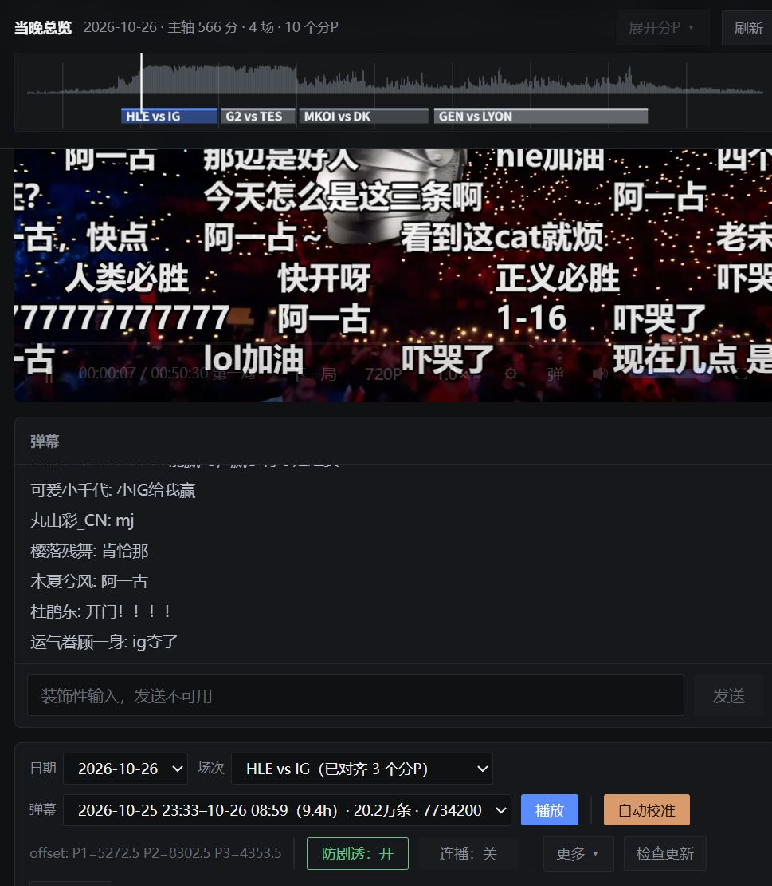
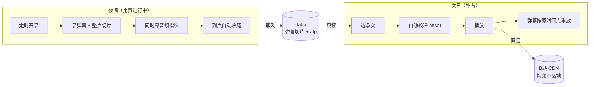

<h1 align="center">弹幕时光机</h1>

<p align="center">录制 B 站赛事弹幕，按原始时间点叠加到官方回放上播放。</p>

<p align="center">
<a href="#效果">效果</a> ·
<a href="#快速开始">快速开始</a> ·
<a href="#原理">原理</a> ·
<a href="#核心机制">核心机制</a> ·
<a href="#开发">开发</a>
</p>

<p align="center">


</p>

> **只看已有比赛、不需要自己录制**：见 [`DISTRIBUTION.md`](DISTRIBUTION.md)。

## 效果

<picture>
  <source srcset="assets/player@2x.jpg 2x">
  
</picture>

界面分四个区域：

| 区域 | 内容 |
|---|---|
| 顶部 | 整晚弹幕密度曲线，按场次分段，附各场起止时间 |
| 中部 | 视频画面，弹幕按 offset 叠加 |
| 右侧 | 当前时刻的弹幕列表（含表情与礼物） |
| 底栏 | 日期、场次、弹幕来源、播放、自动校准、offset 微调、防剧透、连播 |

> 截图为 HLE vs IG，3 个分P 均已对齐：`P1=5272.5 P2=8302.5 P3=4353.5`，
> 置信度 7.2 / 8.5 / 10.5。视频画面来自 B 站官方回放，不在本仓库。

## 防剧透与连播

**防剧透**（默认开启）

隐藏会提前暴露比赛结果的信息：

| 隐藏 | 原因 |
|---|---|
| 进度条时间标记（一血、大龙、推塔） | 标记分布可推断局势与胜负 |
| 总览中的分P 色块 | 色块数量暴露总局数 |
| 场次下拉框与状态栏的分P 数 | 与色块同义，只是写在文字里 |
| 标题与进度条标签里的分P 名（第一局、赛后采访） | 同上 |

保留场次色带（对阵双方）与密度曲线，二者只反映赛程，不含比分。

**连播**（默认关闭）

单场分P 播完后自动切换到下一场，不中断。与防剧透同时使用时，整晚为一条连续时间线。

两项设置均不影响数据，状态保存在浏览器本地。

## 原理



直播弹幕的时间戳基于真实墙钟；官方回放视频使用独立的时间轴。两者相差一个**固定 offset**。

采集弹幕时同步拉取最低清晰度直播流，仅解码音频并计算「音频指纹」（33 个对数频带，不保存音频文件）。随后对官方回放音频计算同类指纹，将两组指纹做互相关，解出 offset。

不使用赛程时间推算的原因：直播可能提前开播、局间有休息、中途插播广告或重播，推算误差可达数分钟。指纹对齐的实测偏差在 **0.2 秒内**。

## 目录

```
lol延时直播/
├── README.md / SCHEMA.md                     ← 用法与配置 / 数据契约
├── DISTRIBUTION.md                           ← 只用作者的数据（不采集）
├── 业务约束.md / 架构总览.md                 ← 禁区与质检 / 模块与架构债
├── 术语表.md / 模块设计/
├── VERSION                                   ← 版本号（唯一来源）
├── LICENSE                                   ← MIT（仅覆盖代码与文档）
├── tools/                                    ← 质量闸门 / 发布校验 / 便携打包 / 拆分对齐
├── tests/                                    ← 对齐算法、分层、布局、清单、更新、版本、字节一致性
├── data/                                     ← 采集产物（两端共用，见 SCHEMA.md）
│   {赛事日}/{房间号}/ manifest + 弹幕切片 + afp
├── danmaku-collector/                        ← 采集端（可单独拷到手机）
│   collector.py / live_audiofp.py / dashboard.py / phone_ctl.py
│   启动采集.bat / 启动控制台.bat / 退出控制台.bat
└── danmaku-server/                           ← 播放端（Python aiohttp + 原生 JS）
    server.py / audiofp.py / srcfetch.py / dataupdate.py / web/
    启动回放台.bat / 启动回放台_局域网.bat / 退出回放台.bat
```

模块职责与依赖方向见 `架构总览.md`。

## 平台与已知限制

| 项 | 说明 |
|---|---|
| 平台 | **仅 Windows**（启动脚本为 `.bat`）。采集端可单独部署到手机 Termux，播放端未做跨平台适配 |
| Python | 需 3.12+，依赖版本已在 `requirements.txt` 精确锁定 |
| 网络 | 视频不落地，播放时直连 B 站 CDN，**需要联网**且受 B 站地区限制 |
| 回放来源 | 仅对「B 站官方账号上传的回放」自动搜索 BV，其他来源需手动填写 |
| 昵称 | 弹幕保留**原始用户昵称**，未做匿名化（详见下方免责声明） |

对齐失败、分P 缺失、音轨更换等技术边界见
[`danmaku-server/README.md`](danmaku-server/README.md#已知边界)。

## 数据来源与免责声明

**数据从哪来**：`data/` 下的弹幕由本项目在 B 站赛事直播间公开直播期间录制，内容与昵称均为直播时**人人可见的公开信息**。音频指纹由直播流的音频计算得出，不存储任何音频。

**版权归属**：弹幕内容与用户昵称的版权归原发布者及哔哩哔哩所有。本仓库对数据**不主张任何权利，也不构成再授权**；`LICENSE` 中的 MIT 许可仅覆盖代码与文档。

**用途**：仅用于个人存档与技术演示（把录播还原成"伪直播"的播放体验），不用于商业目的，不做用户画像或数据分析。

**关于昵称**：录制时保留了原始昵称，是为忠实反映当时的直播间状态，未做匿名化处理。

> **如果你是权利人**，认为本仓库的某部分内容侵犯了你的权益，请通过 issue 或仓库主页的联系方式告知，我会**及时删除相关内容**。请先联系作者，不必直接向平台申诉。

**免责**：本软件按"现状"提供，不对可用性、准确性作任何保证。使用者应自行遵守所在地区法律法规及哔哩哔哩的用户协议。因使用本软件产生的任何后果由使用者自行承担。

## 快速开始

两种使用方式，详细步骤各有专文：

```mermaid
flowchart TD
    A{"使用方式"} -->|"查看已有比赛"| B["路径 A：直接播放<br/>无需 B 站账号，无需挂机"]
    A -->|"录制新比赛"| C["路径 B：自行采集<br/>需在比赛时段开机运行"]
    B --> B1["见 DISTRIBUTION.md"]
    C --> C1["见下方 + danmaku-collector/README.md"]
    style B fill:#204a2a,stroke:#4a8
```



### 路径 A：查看已有比赛 → [`DISTRIBUTION.md`](DISTRIBUTION.md)

包含环境要求、clone 命令、启动方式、数据更新与常见问题。**无需 Python 基础之外的前置知识。**

### 路径 B：录制新比赛 → 下方 + [`danmaku-collector/README.md`](danmaku-collector/README.md)

环境要求：**Windows 10/11 + Python 3.12+**。安装时须勾选 `Add python.exe to PATH`
（[python.org](https://www.python.org/downloads/)）。

| 时间 | 操作 |
|---|---|
| 比赛开始前 | 双击 `danmaku-collector/启动采集.bat`，窗口可最小化，不可关闭 |
| 次日 | 双击 `danmaku-server/启动回放台.bat`（局域网访问用 `启动回放台_局域网.bat`） |
| 之后 | 打开 <http://127.0.0.1:8789> → 选日期与场次 → 播放 → 自动校准 |

官方回放通常在中午前后上传完整。若某场次暂无 BV，中午点击「刷新赛程」补齐。

## 配置（换赛事 / 换房间 / 换时区）

两端各有自己的 `config.json`，**都不进版本库**，改完重启生效。
删掉也能用内置默认值启动，均有 `config.example.json` 可抄。

字段的**权威说明**在两端 README：
[采集端](danmaku-collector/README.md#configjson) / [播放端](danmaku-server/README.md)。

下表列出最常改的几项。

### 采集端 `danmaku-collector/config.json`

| 字段 | 默认 | 说明 |
|---|---|---|
| `rooms` | `[]` | 直播间房间号，可多个。**必填**，留空启动即报错 |
| `earliest_start` | `"now"` | `now` / `HH:MM`（下一次出现）/ `+30m` |
| `latest_end` | `"09:00"` | 自动停止时刻，空串表示不停 |
| `audio_fp` | `true` | 是否采音频指纹。**强烈建议开启**——直播流过后无法补采 |

### 播放端 `danmaku-server/config.json`

| 字段 | 默认 | 说明 |
|---|---|---|
| `port` | `8789` | 网页端口 |
| `host` | `127.0.0.1` | 监听地址。`0.0.0.0` = 局域网可访问（无鉴权，仅在可信网络使用） |
| `discover.league_id` | Worlds | 抓哪个赛事，见下表 |
| `discover.timezone` | `Asia/Shanghai` | IANA 时区名。**Windows 需先 `pip install tzdata`** |

### 赛区与环境变量

| 赛事 | `league_id` | 环境变量 | 作用 |
|---|---|---|---|
| Worlds | `98767975604431411` | `DANMAKU_CONFIG` | 配置路径 |
| LPL | `98767991299243165` | `DANMAKU_DATA` | 数据目录 |
| LCK | `98767991310872058` | `DANMAKU_HOST` | 监听地址 |
| LEC | `98767991302996019` | `RIOT_API_KEY` / `AFP_CACHE` | 覆盖社区 key / 指纹缓存目录 |

**换赛区示例**——录 LPL（北京时间晚上开赛）：

```json
{"discover": {"league_id": "98767991299243165", "window_start": "16:00", "window_end": "23:00"}}
```
采集端相应改 `earliest_start: "16:00"`、`latest_end: "23:30"`。**换直播间**只改采集端 `rooms`，播放端无需改。

`discover.timezone` 用 IANA 名称。**Windows 上 `zoneinfo` 依赖 `tzdata`**，没装会抛
`ZoneInfoNotFoundError`（代码打警告并退回 UTC+8）——时区错了会让赛程窗口整体偏移几小时，
表现为「明明有比赛却一场都没发现」。`pip install tzdata`。

## 核心机制

### 1. 采集

状态机：等待定时 → 轮询开播 → 录制 → 下播等待重开 → 到点收尾。
弹幕按整点切片 gzip，同时还原算音频指纹。实现细节见
[`danmaku-collector/README.md`](danmaku-collector/README.md)。

### 2. 音频指纹自动校准

直播弹幕使用墙钟，回放视频使用独立时间轴，两者相差一个固定 offset。
采集时同步解码直播音频计算指纹（33 频带，0.4s/帧，不保存音频）；
随后与官方回放音频做互相关，解出 offset。

三条关键规则：

| 规则 | 原因 |
|---|---|
| 逐分P 独立对齐 | 回放按局拆分且剪掉局间休息，单一标量从第二局起偏移 200 秒以上 |
| 以投票一致性判定，不依赖单段置信度 | 单段置信度只反映该段音频独特性，BP/解说段天然低至 1.1 |
| 多个自洽位置取最早者 | 早晨重播的音频与回放一致，最早那次才是正在直播的 |

算法细节与采信条件见 [`模块设计/对齐.md`](模块设计/对齐.md)，
实现与实测数据见 [`danmaku-server/README.md`](danmaku-server/README.md#自动校准算法)。

### 2b. 播放时的分段映射

播放器将各分P 首尾相接拼成虚拟轴。因回放剪掉局间休息，每个分P 使用**各自的 offset** 映射。
公式见 `SCHEMA.md` §4.4。

### 3. 赛事日与赛程发现

**赛事日 = 会话结束时刻所在日期。** 跨零点的场次（23:33 开始、次日 08:59 结束）归入结束当天。
目录名确定后不再变更。

流程：Riot esports API 取当日比赛 → 生成场次草稿 → B 站搜索官方账号回放标题匹配两队名 → 回填 BV。
回放未上传时留空，后续刷新补齐。写回规则：**只填空位，不覆盖已有 BV / offset**。

### 4. 手动微调

自动校准不适用时，以 ±30 / 10 / 5 秒逐档校正，即时生效并持久化。

## 日常运维

启停脚本位于各自目录，均为前台运行，关窗即停，不留后台进程。

| 端 | 脚本 | 详见 |
|---|---|---|
| 采集端 | `启动采集.bat` / `启动控制台.bat` / `退出控制台.bat` | [`danmaku-collector/README.md`](danmaku-collector/README.md) |
| 播放端 | `启动回放台.bat` / `启动回放台_局域网.bat` / `退出回放台.bat` | [`danmaku-server/README.md`](danmaku-server/README.md) |

播放端同时支持**仅本机**（`127.0.0.1`）与**局域网**（`0.0.0.0` + 二维码）两种模式，
监听地址由启动脚本显式设置，不受 `config.json` 覆盖。局域网访问需放行防火墙端口 8789，
具体命令见 [`danmaku-server/README.md`](danmaku-server/README.md#局域网访问)。

> 本服务无登录鉴权，局域网模式仅限可信网络。

## 开发

改动前阅读 `业务约束.md`（禁区、质检命令、豁免口径）与 `架构总览.md`（模块、依赖方向、架构债）。
修改数据字段前须阅读 `SCHEMA.md`。

**质检命令以 `业务约束.md` §质检与冒烟 为准**，本文不复制（复制必然漂移）。

## 手机备份节点（可选）

PC 与手机同时采集同一房间，数据独立落盘，单节点故障不致丢失当晚弹幕。

| 项 | 说明 |
|---|---|
| 环境 | Termux + python / numpy / ffmpeg，代码经 `adb reverse` 隧道拉取 |
| 保活 | `termux-wake-lock` + Doze 白名单；vivo 的 ABE 后台管理需手工豁免 |
| 管理 | `phone_ctl.py status\|start\|stop\|log\|pull\|test` |
| 已知限制 | Termux 的 Python 与 numpy 存在 ABI 兼容问题，指纹可能降级（弹幕不受影响） |
