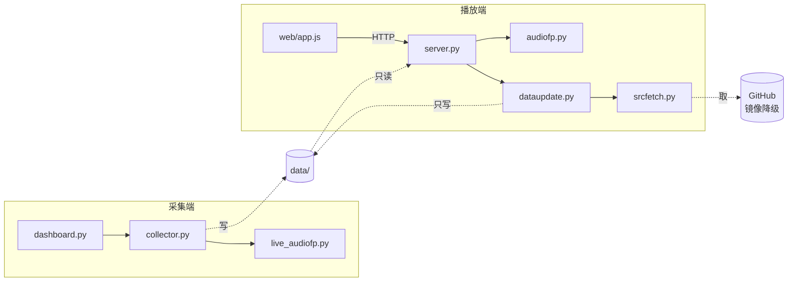
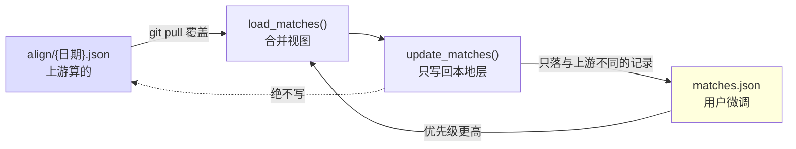

# 架构总览

> 版本 v1 | 最后更新 2026-10-27

## 一句话

把 B 站赛事直播的弹幕整夜采集下来，次日用官方回放的音轨反推时间偏移，在本地网页上还原成一场「正在直播」。

## 模块

| 模块 | 职责 | 禁止依赖 |
|---|---|---|
| `danmaku-collector/collector.py` | WS 收弹幕、整点切片、收尾写 manifest | 播放端任何模块 |
| `danmaku-collector/live_audiofp.py` | 拉低清直播流、增量算音频指纹 | 播放端任何模块 |
| `danmaku-collector/dashboard.py` | 采集端控制台（8787），起停采集任务 | 播放端任何模块 |
| `danmaku-collector/phone_ctl.py` | **本机专属**：adb 控制手机端采集（状态 / 推送 / 拉数据） | 播放端任何模块；不属于分发链路，手机地址走环境变量或参数 |
| `danmaku-server/server.py` | HTTP 接口、逐分P 对齐、B站取流、赛程发现 | 采集端任何模块（**只读它的数据目录**） |
| `danmaku-server/dataupdate.py` | 从 GitHub 增量拉取数据（清单比对 + 原子落盘 + 防路径穿越） | 采集端任何模块；不直接读写 `align/`；不做网络通道选择（交给 `srcfetch`） |
| `danmaku-server/srcfetch.py` | 多通道取文件（镜像降级 + 代理策略 + sha256 校验）。**只依赖标准库，不写任何文件** | 采集端任何模块；不碰 `data/`（它只返回字节，落盘是 `dataupdate` 的事） |
| `danmaku-server/audiofp.py` | 指纹计算 + 互相关对齐库 | 采集端任何模块 |
| `version.py`（两端各一份，内容相同） | 读仓库根 `VERSION`，提供版本比较。**只依赖标准库**，不 import 任何业务模块 | 两端任何业务模块（它要能被两端各自单独拷走） |
| `danmaku-server/align/` | 上游对齐结果（入库、只读，一天一个文件） | 任何写入操作 |
| `danmaku-server/web/` | 纯前端：弹幕引擎、分段映射、总览 | 直接访问文件系统 |

**唯一跨端耦合是文件系统**，方向单向：`server` 读仓库根的 `data/`，`collector` 不知道 `server` 存在。

## 依赖方向

数据在**仓库根** `data/`，与两端代码并列。采集端要能单独拷到手机跑，它的默认 `data_dir`
仍相对脚本目录（手机上是 `~/collector/data/`）；本机靠 `danmaku-collector/config.json`
的 `"data_dir": "../data"` 指到仓库根。这样「代码可单独拿走」与「数据集中一处」互不干扰。

箭头即允许依赖。**两端之间没有 import**（已核：交叉 import 数为 0），可以分别部署——采集端要能单独拷到手机 Termux 上跑。

## 基础设施

| 能力 | 在哪 | 说明 |
|---|---|---|
| 配置 | 两端各自 `config.json` | 都按 `环境变量 > config.json > 代码默认值` 取值；`config.example.json` 是模板 |
| 错误处理 | `server.py` 的 `ApiError` + `error_middleware` | API 错一律转 `{ok:false,error}`，不抛 500 |
| 日志 | 采集端 `logging`；播放端 `print` | 播放端尚未统一，见架构债 |
| 质量闸门 | `tools/quality_gate.py` | 函数 60 行 / 文件 400 行 / 圈复杂度 15 / 死代码 0，退出码说话 |
| 回归 | `tests/run_all.py` | 收集 `tests/test_*.py`。对齐算法、分层与分发契约 |
| 发布校验 | `tools/pack_data.py` | 缺 manifest / 切片 / 赛程时间窗都会拦住；`--index` 生成带 sha256 的清单；`--strip-afp` 出裁剪包 |
| 便携打包 | `tools/build_release.py` | `--slim`(约41MB，不含自动校准) / `--full`(约166MB)；含便携 Python、不带 `data/`；自带冒烟测试断言 `HAS_AUDIOFP` 与包类型一致 |

## 两层对齐记录（分发的基础）

拆开的原因：一个文件同时装「作者算好的」和「用户改的」，既发不出去（被 gitignore）也合不回来（天天冲突）。

## 数据契约

唯一权威来源是 **`manifest.json`**；`meta.json` 仅供人类阅读，不作数据源。字段定义见根目录 `SCHEMA.md`，改字段前必读。

三代目录布局（v1 平铺 / v2 带日期前缀 / v3 纯房间号）在读取层全部兼容，不要为了「统一」去改老数据。

## 关键设计取舍

| 取舍 | 理由 |
|---|---|
| 不下载视频，只存弹幕 + 指纹 | 一晚 15 MB 而非几十 GB；指纹必须实时采集，事后无法补 |
| 逐分P 独立 offset，不用单标量 | 官方回放剪掉了局间休息，单标量从第二局起偏 200 秒以上 |
| 对齐按「投票一致性」而非「单段置信度」 | BP/解说段音频特征天然不独特（conf 低到 1.1），但位置是对的 |
| 多个自洽位置取最早 | 最早那次才是当时正在直播的，其余是早间重播 |
| 指纹算法在两端各留一份 | 采集端要能独立部署到手机，无法共享模块；靠 `tests/test_align.py` 卡逐 bit 等价 |

## 架构债

**只减不增。** 新增超标先看能不能拆；确实要留的登记在此，并在 `业务约束.md` 写明理由。

### 文件超 400 行

**行数不写在这里**：数字会漂，写死就必然对不上，最后变成"看起来有账本、其实没人核对"。
清单和实时行数以 `python tools/quality_gate.py` 为准（退出码 0 且下方 DEBT 项数与本文
登记项一致才算过）。

| 文件 | 打算 |
|---|---|
| `danmaku-server/server.py` | 按「接口 / 对齐 / B站取流 / 目录扫描」四块拆；优先抽 `alignment.py` |
| `danmaku-server/web/app.js` | 按「弹幕引擎 / 播放器 / 总览」拆 |
| `danmaku-collector/collector.py` | `Recorder` 类过大，可拆状态机与落盘 |
| `danmaku-collector/live_audiofp.py` | 轻微超标，暂留 |
| `danmaku-collector/dashboard.py` | 内嵌 HTML，可外置成文件 |

### 函数超 60 行

最该动的三个（行数同样不写死，见闸门输出）：

| 函数 | 为什么难拆 |
|---|---|
| `_align_one_page` | 对齐核心，拆错会静默改变结果；已有回归用例兜底后可拆 |
| `run_autocalign` | 流程编排，依赖会话（aiohttp session） |
| `scan_days` | 三代目录布局兼容分支堆在一起 |

### 圈复杂度超 15

具体函数与数值以 `python tools/quality_gate.py` 为准，不在此抄写。

### 已知缺陷（修好即删）

无。

## 提案（下游填，架构窗裁）

| # | 对象 | 问题 | 建议 | 证据 | 决定 |
|---|---|---|---|---|---|
| | | | | | |
