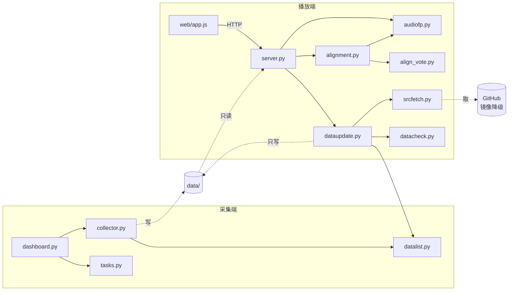
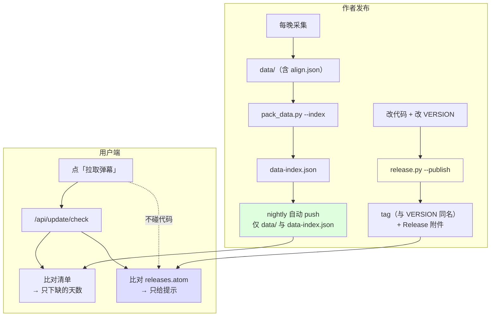
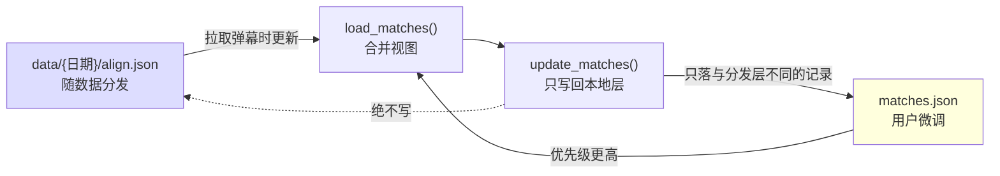

# 架构总览

> 版本 v1 | 最后更新 2026-10-31

## 一句话

把 B 站赛事直播的弹幕整夜采集下来，次日用官方回放的音轨反推时间偏移，在本地网页上还原成一场「正在直播」。

## 模块

| 模块 | 职责 | 禁止依赖 |
|---|---|---|
| `danmaku-collector/collector.py` | WS 收弹幕、整点切片、收尾写 manifest | 播放端任何模块 |
| `danmaku-collector/live_audiofp.py` | 拉低清直播流、增量算音频指纹 | 播放端任何模块 |
| `danmaku-collector/dashboard.py` | 采集端控制台（8787），起停采集任务、任务队列 | 播放端任何模块 |
| `danmaku-collector/tasks.py` | 按日期排队采集的纯调度逻辑（窗口/错过/重叠校验）。**不做 IO** | 播放端任何模块；不启动采集 |
| `danmaku-server/server.py` | HTTP 接口、逐分P 对齐（调用 alignment）、B站取流、赛程发现、换源记录写回（契约见 `SCHEMA.md` §4.1.1） | 采集端任何模块（**只读它的数据目录**） |
| `danmaku-server/dataupdate.py` | 从 GitHub 增量拉取数据（原子落盘 + 并发 + 幂等）；按 `want_afp` 决定是否下音频指纹 | 采集端任何模块；不做网络通道选择（交给 `srcfetch`）；不做"选哪些文件"（交给 `datalist`） |
| `danmaku-server/appupdate.py` | 程序自更新：解析 Release 与更新说明、选通道下载新包、校验 | 采集端任何模块；**不写 `data/`**（那是 dataupdate 的地盘）；不做目录替换（交给 `update_apply.py`） |
| `danmaku-server/update_apply.py` | 替换器：等端口释放、把用户数据带进新目录、改名或就地覆盖、重启。**只用标准库，不 import 本仓任何模块** | 任何业务模块（它会在包被改名一半时被执行，那一刻周边文件的状态都不可信） |
| `danmaku-server/datacheck.py` | 下载后完整性自检（manifest 声明的文件齐全、gzip 可解）。**只读不写** | 采集端任何模块；不碰网络 |
| `danmaku-server/datalist.py` | 解析数据清单、选出待下载文件（含 afp 可选、补指纹与补校准判定）。**纯函数，不做任何 IO** | 采集端任何模块；不 import `dataupdate`（依赖单向）；不碰网络与磁盘 |
| `danmaku-server/srcfetch.py` | 多通道取文件（镜像降级 + 代理策略 + sha256 校验）。**只依赖标准库，不写任何文件** | 采集端任何模块；不碰 `data/`（它只返回字节，落盘是 `dataupdate` 的事） |
| `danmaku-server/audiofp.py` | 指纹计算 + 互相关对齐库 | 采集端任何模块 |
| `danmaku-server/alignment.py` | 逐分P 对齐核心：切段、多段投票、时间窗约束 | 采集端任何模块；HTTP、配置、数据目录 |
| `danmaku-server/align_vote.py` | 投票聚类与采纳判定。**纯计算，不做 IO、不读配置** | 采集端任何模块；网络与磁盘 |
| `danmaku-server/errors.py` | 统一业务错误类型（播放端与对齐模块共用同一个类） | 任何业务模块 |
| `version.py`（两端各一份，内容相同） | 读仓库根 `VERSION`，提供版本比较。**只依赖标准库**，不 import 任何业务模块 | 两端任何业务模块（它要能被两端各自单独拷走） |
| `data/{日期}/align.json` | 随数据分发的对齐结果（入库、只读，一天一个文件） | 任何写入操作 |
| `danmaku-server/web/` | 纯前端：弹幕引擎、分段映射、总览、屏蔽词、换源（逐局人工对齐） | 直接访问文件系统 |

**唯一跨端耦合是文件系统**，方向单向：`server` 读仓库根的 `data/`，`collector` 不知道 `server` 存在。

## 依赖方向

数据在**仓库根** `data/`，与两端代码并列。采集端默认 `data_dir` 相对脚本目录；
本机靠 `danmaku-collector/config.json` 的 `"data_dir": "../data"` 指到仓库根。
这样「两端各自独立运行」与「数据集中一处」互不干扰。

箭头即允许依赖。**两端之间没有 import**（已核：交叉 import 数为 0）：采集端与播放端各自独立启动，
只通过文件系统单向交互。

## 基础设施

| 能力 | 在哪 | 说明 |
|---|---|---|
| 配置 | 两端各自 `config.json` | 都按 `环境变量 > config.json > 代码默认值` 取值；`config.example.json` 是模板 |
| 错误处理 | `server.py` 的 `ApiError` + `error_middleware` | API 错一律转 `{ok:false,error}`，不抛 500 |
| 日志 | 采集端 `logging`；播放端 `print` | 播放端尚未统一，见架构债 |
| 质量闸门 | `规范/gate.py` + `tools/gate.json`（内部跑 `tools/quality_gate.py`） | 行数阈值与豁免在 `tools/gate.json`；复杂度阈值在 `tools/quality_gate.py`；死代码与未用名必须为 0。`.bat` 与文档链接也在这里查。`规范/` 是本机镜像，不入库 |
| 回归 | `tests/run_all.py` | 收集 `tests/test_*.py`。对齐算法、分层与分发契约 |
| 发布校验 | `tools/pack_data.py` | 缺 manifest / 切片 / 赛程时间窗都会拦住；`--index` 生成带 sha256 的清单；`--staged` 按 git 暂存区生成（保证清单哈希 == 提交字节）；`--strip-afp` 出裁剪包 |
| 无头校准 | `tools/calibrate.py` | 不启动播放端，直接对某天官方回放算 offset；只写本地层 |
| 夜间流水线 | `tools/nightly.py` | 每小时巡检：刷新赛程 → 逐分P 校准 → `split_matches --apply` → `pack_data --index --staged` → 本地 commit → 仅纯数据提交自动 push；失败下轮重试 |
| git 推送 | `tools/gitpush.py` | 读 Windows 系统代理、只推指定分支、按瞬时/永久错误分类重试。**不判断推什么**（由 `nightly` 决定） |
| 便携打包 | `tools/build_release.py` | `--slim`(解压约37MB，**对外发布的唯一版本**) / `--full`(解压约163MB，仅供本机手测，不进 Release)；含便携 Python、不带 `data/`；自带冒烟测试断言 `HAS_AUDIOFP` 与包类型一致、且依赖必须来自包内 |
| 一键发布 | `tools/release.py` | 校验 → 闸门 → 回归 → 重生成清单 → 出包 → **空 `APPDATA` 端到端实测** → (可选)打 tag/推送/建 Release。`KINDS` 固定为 `slim`：完整版不发，需要重算的人从源码跑。Release 正文 = `RELEASE_NOTES.md`（固定说明）+ `CHANGELOG.md` 里本版本那一节。任何一步失败即停，不继续往下做 |

## 两条更新链路（数据 / 程序）

两条链**刻意分开**：数据每晚都有、程序只在改功能时才有。合在一起会让"程序版本"
被数据的发布节奏绑架——早先 `app_version` 挤在清单里，只改代码不重生成清单的版本
用户永远发现不了。

## 两层对齐记录（分发的基础）

拆开的原因：一个文件同时装「作者算好的」和「用户改的」，既发不出去（被 gitignore）也合不回来（天天冲突）。

## 数据契约

唯一权威来源是 **`manifest.json`**；`meta.json` 仅供人类阅读，不作数据源。字段定义见根目录 `SCHEMA.md`，改字段前必读。

三代目录布局（v1 平铺 / v2 带日期前缀 / v3 纯房间号）在读取层全部兼容，不要为了「统一」去改老数据。

## 关键设计取舍

| 取舍 | 理由 |
|---|---|
| 不下载视频，只存弹幕 + 指纹 | 一晚 15 MB 而非几十 GB；指纹必须实时采集，事后无法补 |
| 逐分P 独立 offset，不用单标量 | 官方回放剪掉了局间休息，单标量从第二局起偏 200 秒以上 |
| 对齐按「投票一致性」而非「单段置信度」 | BP/解说段音频特征天然不独特（conf 低到 1.1），但位置是对的 |
| 多个自洽位置取最早 | 最早那次才是当时正在直播的，其余是早间重播 |
| 指纹算法在两端各留一份 | 采集端要能独立部署到手机，无法共享模块；靠 `tests/test_align.py` 卡逐 bit 等价 |

## 架构债

**只减不增。** 新增超标先看能不能拆；确实要留的登记在此，并在 `业务约束.md` 写明理由。

### 文件超 400 行

**行数不写在这里**：数字会漂，写死就必然对不上，最后变成"看起来有账本、其实没人核对"。
清单和实时行数以 `python 规范\gate.py --config tools\gate.json` 为准（退出码 0 且下方 DEBT 项数与本文
登记项一致才算过）。

| 文件 | 打算 |
|---|---|
| `danmaku-server/server.py` | 按「接口 / 对齐 / B站取流 / 目录扫描」四块拆；优先抽 `alignment.py` |
| `danmaku-server/web/app.js` | 按「弹幕引擎 / 播放器 / 总览」拆 |
| `danmaku-server/web/style.css` | 主题变量与组件样式混在一处，可拆 `theme.css` + 组件样式（2026-10-31 接入通用规范时纳入扫描的既有存量） |
| `danmaku-collector/collector.py` | `Recorder` 类过大，可拆状态机与落盘 |
| `danmaku-collector/live_audiofp.py` | 轻微超标，暂留 |
| `danmaku-collector/dashboard.py` | 内嵌 HTML，可外置成文件 |
| `tools/release.py` | 发布编排，可把「gh 凭据复用 + Release 正文拼装」继续抽出（代理探测已抽到 `gitpush.py`） |
| `tools/build_release.py` | 打便携包，可把「复制依赖 / 写说明 / 自检」三块各拆一文件 |

> `tools/` 是 2026-10-29 才纳入闸门扫描的：此前 `CODE_DIRS` 只有两端业务目录，
> `release.py` 里一行死代码（`tag = "" if kind == "slim" else ""`）长期免检。
> 上表 `tools/` 两项是**纳入扫描时发现的既有存量**，不是新增；其余项目标同前。

### 函数超 60 行

最该动的几个（行数同样不写死，见闸门输出）：

| 函数 | 为什么难拆 |
|---|---|
| `run_autocalign` | 流程编排，依赖会话（aiohttp session） |
| `scan_days` | 三代目录布局兼容分支堆在一起 |
| `tools/release.py: publish` | 发布编排（检查→出包→实测→推送），拆错会把步骤顺序打乱 |
| `tools/split_matches.py: main` | 日常分发：把本地层记录搬进 `data/{日期}/align.json`；发布前 `release.py --check` 拦住漏搬 |

### 圈复杂度超 15

具体函数与数值以 `python 规范\gate.py --config tools\gate.json` 为准，不在此抄写。

### 已知缺陷（修好即删）

无。

## 提案（下游填，架构窗裁）

| # | 对象 | 问题 | 建议 | 证据 | 决定 |
|---|---|---|---|---|---|
| | | | | | |
