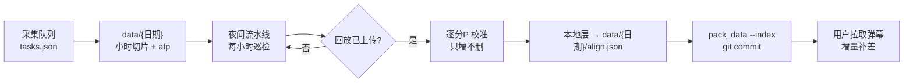

# R-01 夜间采集、校准与发布一体化 需求页

> 创建 2026-10-31 | 版本 v1 | 挂目标：采集—校准—发布一条夜间流水线 | 状态：待审（未定稿）
>
> 级：P0 = 本轮必做；P1 = 一并做；P2 = 有余力再做。未获认可的条目保留在页内「未定」，不写成定论。

## 需求（分点）

### R-01 手机采集下线

- 边界：删除 `danmaku-collector/phone_ctl.py`；删除 `README.md`、`danmaku-collector/README.md` 的「手机备份节点」与 Termux 相关段落；`架构总览.md` 模块表删除该行，「可单独拷到手机」的部署理由改为「两端为独立部署单元」；`业务约束.md` 同理由同步；`version.py` 注释同步；`data/` 与历史数据不动。
- 怎么验证：全仓（排除 `data/`）搜索 `phone_ctl`、`Termux`、`data_phone` 只剩本页与变更记录；质量闸门与回归通过；两端指纹仍各一份且 `tests/test_align.py` 逐 bit 等价全过。
- 级：P1
- 未定：`.gitignore` 里的 `data_phone/` 条目是否删除（改 `.gitignore` 需你明确同意）

### R-02 采集控制台按播放端 web 风格重写

- 边界：视觉沿用 `danmaku-server/web/style.css` 的灰阶底 + 单一点缀色、间距 > 字重 > 边框的分层；页面固定分区为「任务」「赛程」「运行控制」「运行日志」「最近结果」；不引入前端框架与构建链，仍由 `dashboard.py` 进程提供；窄屏可用。
- 怎么验证：人工验收：同一屏只有一种强调色；同层级字号与间距一致；开始/结束/危险操作分组，不混排；说明性文字只保留图例式操作提示与控件标签。
- 级：P1
- 未定：内嵌 HTML 是否外置为独立静态文件（推荐外置；`dashboard.py` 已登记文件行数存量债）

### R-03 按日期排队采集

- 边界：任务表 `danmaku-collector/tasks.json`（本机文件，不入库）；一条任务 = 一晚：`date / start / end / rooms / note / enabled / status`；控制台支持增删改查与启停；队列守护运行在控制台进程内，关窗即停；窗口重叠拒绝保存；错过开始但未到结束 → 立即开录并记日志，已过结束 → 标「错过」；状态跨重启保留；界面同时显示任务日期与将写入的 `data/{日期}`。
- 怎么验证：任务挑选与状态机做成纯函数单测（不做 IO）；手工演练：排两晚任务，第一晚收尾后自动等第二晚；重启控制台后任务表与状态不丢；构造「错过开始」「已过结束」「窗口重叠」三种情况，行为与定义一致。
- 级：P0
- 未定：任务粒度取「每晚一条」还是「每场一条」（推荐每晚；同房间的场次本来连播）

### R-04 提前结束

- 边界：拆成两个动作：**结束本次**（收尾、任务标已结束、队列继续等下一晚）与**停止队列**（收尾并退出）。保留现有「停止 = 收尾」语义，不新增第三条停止路径。
- 怎么验证：手工两场景；两种停止都写出完整 manifest 与 gz；队列状态与任务表一致；无残留进程与占用端口。
- 级：P0
- 未定：无

### R-05 延长本次采集

- 边界：截止时刻改为可变，后台每 ≤15 秒复核一次（替换现在的一次性定时器）；控制台提供「延长 30 分钟」「延长 1 小时」；到点收尾后按钮置灰并说明原因；延长作用于本任务的全部房间。
- 怎么验证：可变截止时间纯函数单测；手工：截止前延长，录制继续且仍只有一个会话目录与一份 manifest；截止后再点无效且有提示；不产生第二个 manifest。
- 级：P0
- 未定：无

### R-06 按赛程生成任务草稿

- 边界：复用夜间流水线的赛程发现（Riot，含官方页兜底）；生成规则：开始 = 首场开赛前 30 分钟，结束 = 末场开赛 + 预计时长 + 60 分钟；只生成草稿，确认后才入任务表；不覆盖手填任务；赛程获取失败时任务表零变化，并给出可执行提示。
- 怎么验证：给定固定赛程桩，生成窗口正确；Riot 全部失败时任务表不变且提示含「稍后重试或手动填写」。
- 级：P2
- 未定：预计时长取值（推荐 Bo3 = 3.5 小时、Bo5 = 5.5 小时起算）

### R-07 控制台显示赛程

- 边界：读 `data/{数据日}/align.json` 的 `lists`（分发层只读）；列显示开赛时间、对阵、BV 是否找到、是否已对齐、是否已发布；「刷新赛程」触发流水线的赛程发现子命令；数据日与比赛日的映射按现有规则显示。
- 怎么验证：有 `lists` 时正确显示；无 `lists` 显示「未刷新」而不是空白；`found=false` 明确标「未找到回放」并允许人工填 BV；不修改任何分发层文件。
- 级：P2
- 未定：是否保留手动「刷新赛程」按钮（推荐保留）

### R-08 校准从播放端分出并可无头运行

- 边界：从 `server.py` 抽 `alignment.py`（`_align_one_page`、`run_autocalign` 与回放取流），`server.py` 只调库；新增 `tools/calibrate.py`，参数 `--date` 配 `--bv` 或 `--all`；不依赖 HTTP 服务；结果写本地层 `matches.json`；**只增不删**：本轮没取到音频的分P 保留旧 offset，不写失败标记；发布由 `split_matches --apply` 搬入 `data/{日期}/align.json`。
- 怎么验证：`tests/test_align.py` 全过；对 `data/2026-10-26`、`data/2026-10-27` 重算，offset 与既有记录一致（基线见 `模块设计/对齐.md`）；关闭播放端进程后 CLI 可跑；人为制造「回放暂不可用」，旧 offset 不变。
- 级：P0
- 未定：是否保留 `/api/autocalign`（推荐保留，复用同一库）

### R-09 夜间流水线：每小时巡检 → 对齐 → 发布

- 边界：新增 `tools/nightly.py`；每小时巡检一次：①有新封口的小时切片 → 刷新当天 manifest（不归档旧 manifest，不写正在写的切片）；②对当天 BV 未对齐或对齐不全的分P 调 R-08；③有新增内容才 `split --apply` → `pack_data --index` → `git commit`；回放未上传或取不到音频 → 静默跳过，下轮重试；push 默认不做；任一步失败退出码非 0、不留下半写文件；校准失败不阻塞已发布内容。
- 怎么验证：对现有 `2026-10-31` 演练：连续跑两次，第二次零改动零提交；断网时提交失败且工作区无半写文件；`pack_data` 校验通过；`release.py` 的对齐分发检查通过；回放不可用时不产生失败记录。
- 级：P0
- 未定：巡检间隔（推荐 1 小时，与你原话一致）；流水线启动方式（随采集 / 单独窗口 / 计划任务）

### R-10 用户端可重复更新

- 边界：用户端比对本地 manifest 与远端清单里的 manifest 哈希；不一致则按清单补缺失或变化的文件；已有且哈希一致不重下；`align.json` 沿用现有哈希补差；界面提示「数据有更新」。
- 怎么验证：扩展 `tests/test_update.py`：夜间快照 → 收尾版，第二次 check 报有更新，只下载新增文件；已下文件不重下；截断文件仍被修复；老清单（无 sha256）不报错。
- 级：P0（不做则 R-09 对老用户无效）
- 未定：afp 发布策略（推荐收尾时一起推；小时切块列为后续提案）

### R-11 数据契约与清单

- 边界：manifest 支持「采集期间刷新」的语义；不新增字段时 `schema_version` 不变；`data-index.json` 继续由 `pack_data --index` 生成；`align.json` 字段不变；`SCHEMA.md` 同步说明「manifest 可能在采集期间更新」。
- 怎么验证：`pack_data` 通过；`tests/test_data_bytes.py` 全过；`SCHEMA.md` 字段表与实现逐项对得上；若新增字段则 `schema_version` +1 并升主版本。
- 级：P1
- 未定：是否需要 `partial` / `updated_at` 字段（推荐不加，靠 manifest 哈希变化驱动更新）

### R-12 文案与命名专业化

- 边界：面向用户的描述统一遵守价值观：第一句给判断；事实与判断分开；不写没有出处的数字；不解释实现原理；错误提示给可执行动作。启动脚本命名与窗口标题统一，建议：采集端 `启动采集.bat` / `退出采集.bat`，播放端 `启动回放台.bat` / `启动回放台-局域网.bat` / `退出回放台.bat`；`.bat` 保持 UTF-8 无 BOM + CRLF。
- 怎么验证：人工审读清单；`git diff --check`；`.bat` 编码与行尾由 `.gitattributes` 及现有回归保障；脚本名与文档引用一致（文档死链检查通过）。
- 级：P1
- 未定：播放端英文脚本名是否统一改中文（会改用户可见入口，推荐改，需你确认）

### R-13 文档同步

- 边界：`AGENTS.md`（本机）、`README.md`、`DISTRIBUTION.md`、`架构总览.md`、`业务约束.md`、`SCHEMA.md`、`模块设计/对齐.md`、`CHANGELOG.md`、`VERSION` 同步；一个事实一个家，不复制数字。
- 怎么验证：`python 规范\gate.py --config tools\gate.json` 的文档死链检查通过；`release.py` 前置检查通过；全仓搜索旧入口名与手机采集描述，只允许出现在变更记录。
- 级：P1
- 未定：版本号升次还是升主（若新增数据字段则主；否则次）

## 整体流程

## 明确不做

| 项 | 原因 |
|---|---|
| 自动 push | 未获长期授权；默认只自动 commit，push 前停下 |
| afp 小时切块 | 改动采集端音频链路，先按收尾发布观察；要做单列提案 |
| 按「每场打完」触发发布 | 你已确认实现麻烦，改用每小时巡检 + 有新增才发 |
| 合并两端指纹算法或共享模块 | 两进程独立部署，合并风险大、收益小 |
| 手机采集兼容入口 | 已明确下线，不留降级开关 |
| 在采集进程内跑校准 | 校准依赖 numpy/ffmpeg，失败应隔离于采集 |
| 自动覆盖手填任务 | 赛程会改期，手动任务优先 |
| 引入前端框架或构建链 | 控制台是本地工具，保持单进程可直接启动 |
| 删除 `data/` 下任何产物 | 指纹不可再生，红线 |

## 已定取舍

| 定了 | 因为 |
|---|---|
| 手机采集下线 | 你明确「把手机那份废弃，不再使用手机采集」 |
| 校准从播放端分出、可无头运行 | 你要求「把校准从播放器里面分出来」 |
| 每小时巡检、回放上传即对齐发布 | 你提出「按小时保存一次，然后拉取官方回放有没有上传，有就对准之后把数据发布」 |
| 用户端必须能重复更新 | 你明确「用户侧的行为应该是可以重复更新」 |
| 按赛程采集以手动为主 | 你判断「手动靠谱点也好做」 |
| 采集控制台按播放端风格重写、文案专业化 | 你要求「参考 web 前端风格重写」「所有描述符合价值观」 |

## 未定

| 项 | 待定内容 | 错了怎么办 |
|---|---|---|
| push 授权 | 只自动 commit，还是长期授权自动 push | 默认只 commit；要自动 push 再补一条长期授权 |
| 巡检间隔与启动方式 | 1 小时 / 更短；随采集 / 独立窗口 / 计划任务 | 间隔可配置；启动方式不影响数据产物 |
| 任务粒度 | 每晚一条 / 每场一条 | 改任务表结构，一次迁移 |
| 控制台 HTML | 内嵌 / 外置静态文件 | 外置后回退成本低 |
| afp 发布策略 | 收尾推 / 小时切块 | 先收尾；切块可后补，但需重做发布时间线 |
| manifest 字段 | 不加字段 / 加 `partial` 与 `updated_at` | 加字段则 `schema_version` +1，升主版本 |
| 播放端脚本名 | 保留英文 / 统一中文 | 改名会改用户入口，需同步全部文档 |
| `.gitignore` 清理 | 删 `data_phone/` 条目 | 需你明确同意后才改 |

## 变更提案（发包后填）

| # | 对象 | 问题 | 建议 | 证据 | 决定 |
|---|---|---|---|---|---|
| | | | | | |
